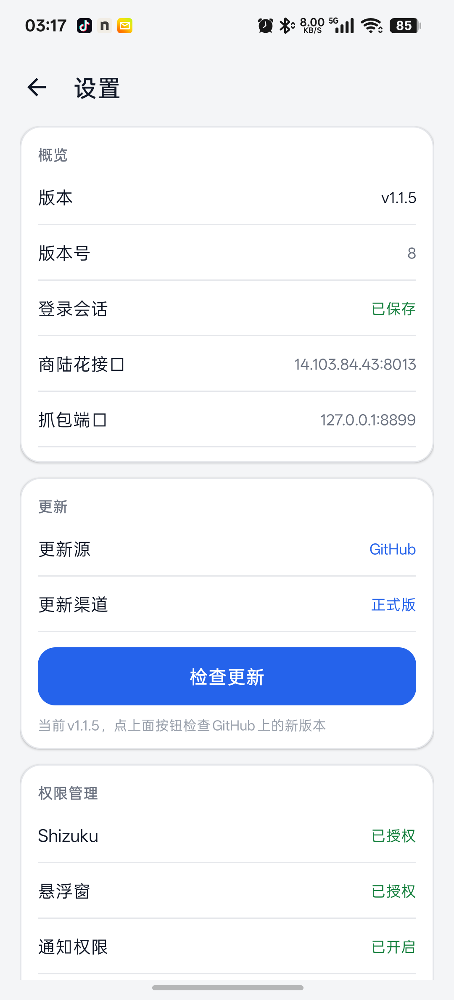

# 入库助手（商陆花 × 微信笔记）

**当前版本：v1.5.8（有 Shizuku 一键自动抓，约 2 秒）**
安装包：`releases/入库助手-v1.5.8.apk`

把微信群里发的商品笔记，一条条录进商陆花的货品档案。手机上独立运行，不需要电脑。




## 能做什么

- 粘贴微信笔记，一键导入商陆花「货品档案」，库存为 0
- **本地识图**：对着色卡/货盘图点「识图」，离线 OCR 出颜色文字直接填进笔记（不走云端，APK 约 33MB）
- **也能直接粘 Excel**：从表格里复制一块（制表符分隔）粘进来就能导，每行可以带自己的进货价
- **复制完从通知栏点回 App，自动把剪贴板里的笔记填好**（不用再点「粘贴」）
- 笔记没写「名称」时，自动用「成份」那行顶上
- 表格模式：有表头就按列名对（款号/名称/颜色/尺码/进货价，列序随便），没表头就按这个固定列序
- 支持 5 种写法：标准【】格式、随手写、款号连写名称、批量多条、**无标签笔记**（`8806，卷边半高领，成分。M，L，XL三码` + 下面一片颜色）
- **点导入先进预览**：逐条列出解析结果，标出「将新建 / 已存在 / 缺字段 / 要新建的颜色」，点某条能直接改字段
- 已存在的款号会顺手读一遍商陆花的现有颜色，直接告诉你「现有 N 色、缺哪几个」
- **已存在的款号会自动补色**：把缺的颜色和 SKU 直接写回商陆花，不用手动加
- 自动解析款号 / 名称 / 颜色 / 尺码；缺必填项会单独提示并跳过
- 颜色会自动对到现有的：写「暗靛蓝」会用「暗靛蓝色」，写「米白色」会用「米白」，不再重复建
- 同名款号自动查重；缺的颜色自动创建
- 可选进货价（一次填入本次全部新建货品）
- 选图用自带界面：4 列相册网格，**选中的图带绿色序号**（跟微信一样），选完还能调
- 最多 9 张图片，随货品一起上传：**长按拖动排序**（上传顺序就按这个次序）、**点一下看大图**、长按进入编辑后左上角出现 ⛔ 删除（像 iOS）
- **有 Shizuku 时一键自动抓会话**：打开商陆花，从它启动时的明文请求里直接取会话，约 2 秒；抓到还会先校验这个会话真能用
- 没有 Shizuku 也能用：手动两步（VpnService 只代理商陆花）照样抓
- 会话抓取一次长期保存；失效自动重抓（有 Shizuku 时不用你动手）
- 本次结果、逐条日志、失败原因，界面里直接看；日志还能一键「分享日志」发人
- 导入全部成功会自动清空笔记和图片，方便贴下一条
- 万一上次抓会话崩了留下系统代理，打开 App 会自动清掉（不再整机断网）
- 设置页：权限管理（Shizuku 可选 / 悬浮窗 / 通知 / 电池白名单）、GitHub 检查更新、下载安装
- 抓会话用只代理商陆花的本地 VPN，**不需要 Shizuku**，也不改系统全局代理

## 快速开始

1. 安装 APK
2. 复制微信笔记 → 从通知栏点「入库助手」或直接切回 App（笔记会自动填好）→ 点「导入到商陆花」
3. 第一次用先抓一次会话：

**有 Shizuku（推荐，全自动）**

- 手机装好 **Shizuku** 并启动服务，给「入库助手」授权
- 回 App 点「自动抓取会话」→「开始」，剩下的它自己做：
  打开商陆花 → 点进「货品」页 → 临时挂系统代理 → 长距离下拉刷新 → 抓到会话 → 恢复代理 → 切回 App
- 全程约 2 秒，商陆花只闪一下

**没有 Shizuku（手动两步）**

- 先把商陆花正常打开到「货品」页面（这一步不挂代理，不会卡）
- 回 App 点「抓取登录会话」→「开始抓取」→ 切回商陆花下拉刷新
- 抓到会话后代理会自动关闭（最多等 2 分钟，卡住可回来点「取消抓取」）

顶栏徽章显示当前状态：

| 徽章 | 含义 | 怎么办 |
| --- | --- | --- |
| 绿色 已就绪 | 会话可用 | 直接导入 |
| 蓝色 待抓会话 | 还没抓过或已失效 | 按两步流程：先开商陆花到「货品」页，再点「抓取登录会话」 |
| 橙色 待授权 | Shizuku 在跑但没给权限 | 点徽章，在弹窗里允许 |
| 红色 Shizuku 未运行 | 服务没启动 | 先到系统里启动 Shizuku |

导入时徽章会显示进度（如「导入 3/10」），下方日志逐条写明成功、跳过或失败的原因。

### 自动抓取是怎么做的

有 Shizuku 时，整段操作跑到 Shizuku 的 shell 进程里（`app_process` 起 `ShellAuto`），
所以商陆花到前台、本 App 被系统冻结也不影响流程：

1. 临时把系统代理指向 `127.0.0.1:8899`（被占用会自动换 8900 / 8901）
2. **在商陆花启动前**就把加密数据隧道设成「拦截」，再 `am force-stop` / `am start` 冷启动它
3. 商陆花启动时的接口请求直接走明文，`sessionid` 随请求带出来（实测 1 秒左右）
4. 抓到先用 `colors` 接口校验这个会话真能调通，校验通过才算数
5. 立刻把系统代理恢复成原来的设置，切回入库助手

请求体在转发前会先读下来扫一遍，所以哪怕这个请求在商陆花里报「网络连接错误」，
`sessionid` 也一样能抓到。

启动请求没带出来的话（比如它走了缓存），才退回老办法：点「货品」→ 不行再下拉刷新 →
还不行就重开一次商陆花用读界面的稳妥流程。

抓不到会退回手动两步，不会卡住你。

### 实测记录（改代码前先看）

- **在它启动前就掐隧道**，启动请求 1 秒内就带出会话（原来等它起来再点「货品」要 10 秒）
- 冷启动后 **3.0 秒点「货品」会点空**，3.5 秒之后才稳（兜底路径用得到）
- 下拉刷新要**从列表顶部拉到屏幕底部、慢拉 1 秒以上**才触发，拉短了商陆花毫无反应
- 商陆花**在后台会被冻结**：后台待 20 秒零请求，叫回前台同一刻请求就出来
- 因此「热启动复用已在后台的商陆花」不可靠（数据有缓存、旧隧道已断、后台又被冻结），
  每次自动抓取都走冷启动
- 剪贴板：App 在前台能读；切到微信后（App 在后台）被系统拒绝；Shizuku/shell 身份直接抛异常，
  跟前台是谁无关。所以「打开笔记就弹通知读内容」这条路不存在
- **没有直达「货品」页的入口**：拆包确认商陆花是 React Native 单页应用，只有 `MainActivity`，
  没有独立货品页 Activity，也没注册自定义 scheme；试过 `am start -a VIEW -d "slh://goods"` 等三种写法，
  全部落在首页（`goods=0 home=1`）。所以只能点一下，别在深链上再花时间

### 抓会话为什么要分两步

商陆花启动时会连一批加密服务；这些连接经过抓包代理容易卡住，表现就是一直停在启动页。
所以现在先让它正常启动到「货品」页，再短暂开启代理，只抓刷新时的接口请求。
抓到 sessionid 会立刻关闭代理，抓取中随时可以取消。

### 抓会话前先关梯子

如果手机开着梯子 / VPN，本机 DNS 会把商陆花域名解析成 `28.0.6.x` 假 IP，只有梯子能转发。
抓包代理连不上这些假 IP，商陆花就会卡在启动页。App 检测到 VPN 会弹窗提醒，**先关掉梯子再抓**。

会话失效时如果商陆花不在运行，App 不会再自动挂代理，而是提示你先按上面的步骤打开商陆花。

## 构建

在手机上的 Ubuntu 环境：

```bash
cd slh-app
./build.sh          # 产出 build/app.apk
adb install -r build/app.apk
```

依赖：JDK 17+、aapt2（build-tools 29）、D8（r8.jar）、API 30 的 android.jar、
Shizuku 的 api / aidl / provider 三个 aar（`libs/`），代理相关 jar 在 `libs-proxy/`。

构建脚本默认从 `/root/workspace` 下找 `platform30`、`r8.jar`、`debug.keystore`，
可用环境变量覆盖：`ANDROID_SDK`、`BUILD_TOOLS`、`ANDROID_JAR`、`R8_JAR`、`KEYSTORE`、`KS_PASS`。

## 目录

- `src/com/slh/app/` — Android App（Java，不依赖 AndroidX）
  - `MainActivity` 界面与导入流程
  - `SlhApi` 商陆花接口封装
  - `NoteParser` 笔记解析
  - `AutoCapture` 自动点按与下拉刷新
  - `ShellAuto` 在 Shizuku shell 里跑整段自动化（不受 App 冻结影响）
  - `AutoGuardService` 自动期间的前台通知
  - `ProxyCatcher` / `SessionCatcher` 抓 sessionid
  - `SettingsActivity` 设置、权限与 GitHub 更新
  - `CaptureVpnService` 只代理商陆花的 VpnService 抓会话
- `res/` — Material 主题、卡片/按钮背景、矢量图标
- `docs/screenshot.png` — 界面截图
- `releases/` — 发布包

## Python 接口版（备用）

早期方案，在 Termux/proot 里跑，通过商陆花 HTTP 接口直接建货品，仍可用。

- `api_import.py` — 接口封装（登录会话、查颜色尺码、建货品、传图）
- `note_parser.py` — 笔记解析（款号/名称/颜色/尺码）
- `session.py` — 抓取 sessionid（本地 mitmproxy + 手机代理）
- `entry.py` — 浏览器网页入口（批量队列、实时进度）：`python3 entry.py` → `http://127.0.0.1:5055`
- `ocr.py` — 从图片识别颜色（已停用，太慢）

## 已知限制

- Shizuku 被系统杀掉后需要重新拉起（OPPO / 一加等系统会定期清理）
- 抓会话时商陆花要已登录，并打开一次「货品」页
- 自动抓取期间系统代理会指向本机几秒（抓完立刻恢复），这几秒里其他 App 的请求也走本机代理
- 自动抓取依赖 Shizuku 一直活着；Shizuku 被系统杀掉时会退回手动流程触发请求
- 商陆花切到后台会被系统冻结（和本 App 一样），页面加载会停住；抓会话那几秒必须让它留在前台，不能提前切回 App
- 因为会被冻结 + 页面有缓存，「复用后台已打开的商陆花」不可靠，所以每次自动抓取都是冷启动（约 10 秒）
- 商陆花接口是明文 HTTP，会话靠本地代理抓取
- 微信窗口有 FLAG_SECURE，截屏/内嵌预览不可用，无障碍树也是空的
- 剪贴板只有 App 在前台时能读：后台（包括 Shizuku / shell）一律被系统拒绝，所以「自动填」必须在回到 App 的那一刻发生
