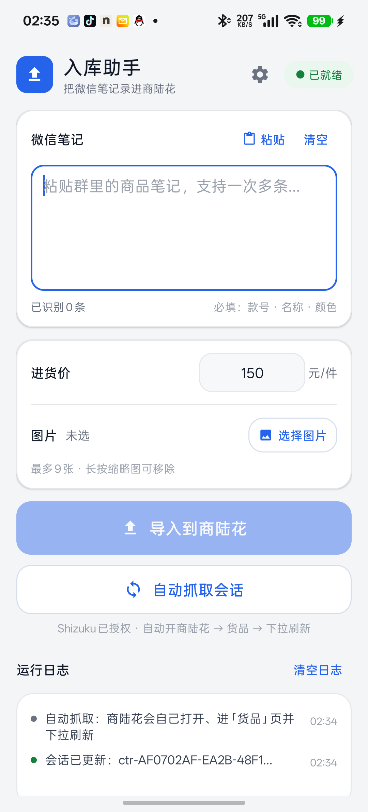

# 入库助手（商陆花 × 微信笔记）

**当前版本：v1.1.3（自动重启商陆花抓会话）**
安装包：`releases/入库助手-v1.1.3.apk`

把微信群里发的商品笔记，一条条录进商陆花的货品档案。手机上独立运行，不需要电脑。



## 能做什么

- 粘贴微信笔记，一键导入商陆花「货品档案」，库存为 0
- 支持 4 种写法：标准【】格式、随手写、款号连写名称、批量多条
- 自动解析款号 / 名称 / 颜色 / 尺码；缺必填项会单独提示并跳过
- 同名款号自动查重；缺的颜色自动创建
- 可选进货价（一次填入本次全部新建货品）
- 最多 9 张图片，随货品一起上传
- 会话抓取一次长期保存；失效自动重抓
- 本次结果、逐条日志、失败原因，界面里直接看

## 快速开始

1. 安装 APK
2. 手机装好 **Shizuku** 并启动服务，给「入库助手」授权
3. **先关闭梯子 / VPN**（开着会让商陆花卡在启动页，App 也会弹窗提示）
4. 打开 App → 点「抓取登录会话」→ App 会自动重启商陆花并等它同步，最多 2 分钟 → 等提示“会话已更新”
5. 复制微信笔记 → 回到 App 点「粘贴」→ 点「导入到商陆花」

顶栏徽章显示当前状态：

| 徽章 | 含义 | 怎么办 |
| --- | --- | --- |
| 绿色 已就绪 | 会话可用 | 直接导入 |
| 蓝色 待抓会话 | 还没抓过或已失效 | 点「抓取登录会话」 |
| 橙色 待授权 | Shizuku 在跑但没给权限 | 点徽章，在弹窗里允许 |
| 红色 Shizuku 未运行 | 服务没启动 | 先到系统里启动 Shizuku |

导入时徽章会显示进度（如「导入 3/10」），下方日志逐条写明成功、跳过或失败的原因。

抓会话前如果开着梯子，点「抓取登录会话」会直接弹窗提示先关闭。
抓会话期间不要切走，等 App 自动打开商陆花完成同步。

## 构建

在手机上的 Ubuntu 环境：

```bash
cd slh-app
./build.sh          # 产出 build/app.apk
adb install -r build/app.apk
```

依赖：JDK 17+、aapt2（build-tools 29）、D8（r8.jar）、API 30 的 android.jar、
Shizuku 的 api / aidl / provider 三个 aar（`libs/`），代理相关 jar 在 `libs-proxy/`。

构建脚本默认从 `/root/workspace` 下找 `platform30`、`r8.jar`、`debug.keystore`，
可用环境变量覆盖：`ANDROID_SDK`、`BUILD_TOOLS`、`ANDROID_JAR`、`R8_JAR`、`KEYSTORE`、`KS_PASS`。

## 目录

- `src/com/slh/app/` — Android App（Java，不依赖 AndroidX）
  - `MainActivity` 界面与导入流程
  - `SlhApi` 商陆花接口封装
  - `NoteParser` 笔记解析
  - `ProxyCatcher` / `SessionCatcher` 抓 sessionid
- `res/` — Material 主题、卡片/按钮背景、矢量图标
- `docs/screenshot.png` — 界面截图
- `releases/` — 发布包

## Python 接口版（备用）

早期方案，在 Termux/proot 里跑，通过商陆花 HTTP 接口直接建货品，仍可用。

- `api_import.py` — 接口封装（登录会话、查颜色尺码、建货品、传图）
- `note_parser.py` — 笔记解析（款号/名称/颜色/尺码）
- `session.py` — 抓取 sessionid（本地 mitmproxy + 手机代理）
- `entry.py` — 浏览器网页入口（批量队列、实时进度）：`python3 entry.py` → `http://127.0.0.1:5055`
- `ocr.py` — 从图片识别颜色（已停用，太慢）

## 已知限制

- Shizuku 被系统杀掉后需要重新拉起（OPPO / 一加等系统会定期清理）
- 抓会话时商陆花要已登录，并打开一次「货品」页触发请求
- 商陆花接口是明文 HTTP，会话靠本地代理抓取
- 微信窗口有 FLAG_SECURE，截屏/内嵌预览不可用（不影响粘贴笔记）
